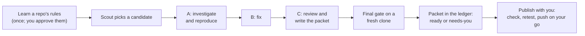

# contrib-pipeline

An unattended pipeline that finds, reproduces and fixes small defects in an open source
repository, and leaves each fix as a reviewed packet for a person to publish. Every Claude
session it starts runs in a sandbox with no way to push, open a pull request or post; the
driver itself only reads from GitHub, and its clone cannot push. Publishing is a separate,
interactive step that pushes only on an explicit "push and open".

It runs as two Claude Code skills: `contrib-one` (the unattended run) and `contrib-publish`
(publishing a finished packet with you).

## How it works



- **Learn.** Two sessions read the repo's contribution guides and its merged and closed
  outside PRs, and write the rules a contribution has to follow. You read
  `PROFILE-REVIEW.md` and approve the rules by id before any run uses them.
- **Run.** Each stage is a fresh headless `claude -p` session in a bubblewrap sandbox. The
  driver, not the model, runs every build and test and records the results, and the final
  gate re-runs them on a fresh clone. A stage that needs a decision stops as needs-you with
  one question.
- **Publish.** `contrib-check` reports whether upstream moved or an open PR overlaps;
  `contrib-run --retest` re-runs the checks when needed; the repo's CI can run on your fork
  first; `contrib-push` pushes exactly the reviewed commit and opens the PR.

Sample output: `contrib-one/examples/packet.md` (a candidate's packet) and
`contrib-one/examples/profile-review.md` (a learned-rules review).

## Built for

This is set up for one machine and has not been tuned for others:

- **Windows with WSL2.** The WSL disk image lives on the C: drive, so the driver and the
  build guard watch C: free space through `/mnt/c`. A run starts only with at least 32 GB
  free, stops after the current stage below 32 GB and at once below 26 GB, and the guard
  kills a build below 20 GB.
- **12 GB of RAM for WSL** (of a 16 GB host) and 3 GB of swap. Builds and tests run one at a
  time, cargo at `-j 4`, and the guard kills a job when available memory drops below 2 GB.
- **Folders under your home:** this repo at `~/contrib-pipeline`, the ledger at
  `~/contrib-queue`, and the work area (clones, environments, build folders, pinned tools)
  at `~/contrib-work`. `CONTRIB_LEDGER` and `CONTRIB_WORK` move the last two.
- **Repo profiles hold this machine's paths** (`REPO_DIR`, `USER_REPO_DIR`, `GUARD`, `TOOLS`).

## Requirements

- Python 3 (tested on 3.12; standard library only).
- Claude Code (`claude`), plus a long-lived token from `claude setup-token` saved at
  `~/.config/contrib/claude-token` with mode 600 (`CONTRIB_TOKEN_FILE` moves it). The
  driver refuses to start without it.
- A `code-reviewer` agent at `~/.claude/agents/code-reviewer.md`. Stage C must run it, and a
  candidate whose stage C transcript has no code-reviewer call is refused.
- The GitHub CLI (`gh`), signed in.
- git, bubblewrap (`bwrap`) and `socat`.
- rustup with a cargo toolchain: the sandbox mounts `~/.rustup` and `~/.cargo/bin` for every
  repo, so both must exist even for a Python repo.
- Each repo's own tools, named in its profile; for pydantic, a pinned `uv` in `TOOLS`.

## Layout

| Path | What it is |
|---|---|
| `contrib-one/` | The driver skill (`SKILL.md`). `bin/contrib-run` runs the loop (learn, scout, stages A, B and C, final gate, retest); `bin/contrib-check` checks a branch for overlap and base drift; `bin/contrib-push` publishes one reviewed commit; `bin/xq` lets xerj sessions reach their scratch node. `rules/`, `stages/` and `profiles/` are what the sessions read; `examples/` has sample output. |
| `contrib-publish/` | The interactive publish skill (`SKILL.md`). |
| `tools/guarded.sh` | The build guard: one job at a time, disk and memory floors, `-j 4`. |
| `tests/` | `smoke/suite.sh` runs the driver end to end against a stub Claude (`contrib-one/tests/stub-claude`); `smoke/unit*.py` and `exploit/` are targeted checks; `learn/` scores learned rules against a hand-written baseline. |
| `SPEC.md` | The specs for learning rules (phase 1), running any repo's own commands (phase 2) and publishing any repo (phase 3). |
| `contrib-one/DESIGN.md` | The full design and the record of every review round. |
| `notes/` | Findings from the first real run and the whole-pipeline review. |

## Install

Create the ledger as a local git repo (the driver commits to it; it has no remote), and link
the two skills into Claude Code:

```bash
git init ~/contrib-queue
mkdir -p ~/.claude/skills
ln -s ~/contrib-pipeline/contrib-one ~/.claude/skills/contrib-one
ln -s ~/contrib-pipeline/contrib-publish ~/.claude/skills/contrib-publish
```

## Add a repo

1. **Make the pipeline clone.** It needs full history (the driver refuses a shallow clone),
   a remote named as the profile's `UPSTREAM_REMOTE`, and every remote's push URL set to
   `no_push`:

   ```bash
   git clone --origin upstream https://github.com/<owner>/<name>.git ~/contrib-work/repos/<name>
   git -C ~/contrib-work/repos/<name> remote set-url --push upstream no_push
   ```

   For publishing you also need your own clone of your fork (`USER_REPO_DIR`), whose
   `origin` is a fork owned by the profile's `CONTRIBUTOR`.
2. **Write `contrib-one/profiles/<owner>-<repo>.env`.** The driver's built-in cargo mode is
   specific to xerj (its YAML suite and scratch node). Every other repo, Rust included, gives
   its own setup, test and check commands (`SETUP_CMD`, `TEST_CMD`, `CHECKS`). The two
   example profiles are the full reference: `xerj-org-xerj.env` (cargo mode) and
   `pydantic-pydantic.env` (Python). `SPEC.md` explains the keys (phase 1, "Commands";
   phase 2, "Commands mode"; phase 3, "Profile keys"). The driver refuses a profile that
   lacks a key it needs and names it; publishing also needs `SENSITIVE_PATHS` and `AREAS`,
   which `contrib-check` checks.
3. **Give it rules.** Either learn them, read the review and approve them:

   ```bash
   ~/contrib-pipeline/contrib-one/bin/contrib-run --repo <owner/name> --learn
   ~/contrib-pipeline/contrib-one/bin/contrib-run --repo <owner/name> --approve-profile <id>
   ```

   The review is `~/contrib-queue/repos/<owner>-<repo>/PROFILE-REVIEW.md`. Or write
   `contrib-one/profiles/<owner>-<repo>.md` by hand; a hand-written file wins over learned
   rules (xerj uses one).
4. Optionally add `contrib-one/profiles/<owner>-<repo>.overrides.md` with your own rules
   for that repo, such as the exact AI disclosure line.

## Run

```bash
setsid nohup ~/contrib-pipeline/contrib-one/bin/contrib-run --repo <owner/name> --limit 1 --hours 6 > /dev/null 2>&1 &
```

- Stop with `touch ~/contrib-queue/STOP` (after the current stage) or `STOP-NOW` (at once).
- Answer a needs-you question with
  `~/contrib-pipeline/contrib-one/bin/contrib-run --repo <owner/name> --answer SLUG "text"`;
  continue stopped work by adding `--resume` to a run.
- Results: `~/contrib-queue/QUEUE.md`, each run's `runs/<run-id>/SUMMARY.md`, and each
  candidate's `candidates/<slug>/session/packet.md`.

## Publish

In a Claude Code session, ask to publish a candidate (the `contrib-publish` skill). It
checks what changed, retests only when needed, offers a CI run on your fork when the profile
sets `FORK_CI=1`, shows you the PR title and body, and runs `contrib-push` only on your
"push and open".

## Tests

From the repo root:

```bash
fail=0; for f in tests/smoke/unit*.py; do python3 -I "$f" contrib-one/bin/contrib-run || fail=1; done; [ "$fail" = 0 ]
bash tests/smoke/suite.sh
```

The suite needs no GitHub access and no real Claude, but it copies the xerj pipeline clone
(the xerj profile's `REPO_DIR`, with an `upstream` remote) and needs bwrap and socat. It
prints `SUITE PASS` and leaves its files in `~/contrib-smoke/<stamp>`. Both commands must
pass before every commit.
