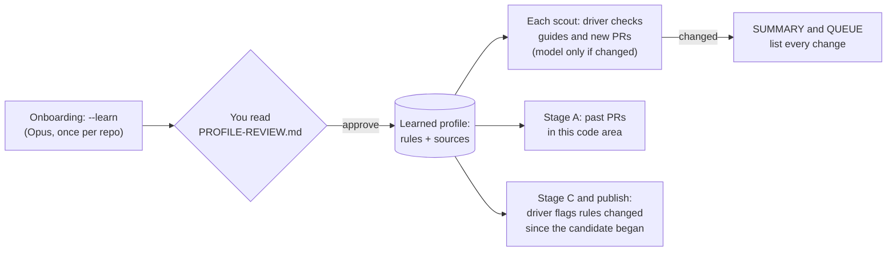

# SPEC: phase 1, the pipeline learns each repo's contribution rules

**Approved 2026-11-11, with both recommended decisions (see the end).**

## Objective

Today the pipeline knows how to contribute to one repo, xerj-org/xerj, because a 101-line
profile (`contrib-one/profiles/xerj-org-xerj.md`) was written by hand. Phase 1 replaces that
hand knowledge with a **learned profile**. The pipeline reads the repo's own guides and the
PRs outside contributors got merged (and the ones maintainers closed, with their reasons),
then writes the rules it found, with a **checked source for every rule**. It rechecks those
rules where they matter.

It is for you, reviewing a run's output: you should be able to trust that a packet and PR
body follow what this project accepts, and see at once when the project's rules changed.

**Done means:** a learned profile for xerj-org/xerj covers what the hand profile says (or
explains each gap), you approve it, and a real run on it produces a packet and PR body at
least as good as run 2's.

**Out of scope:** learning build and test commands (layer 2: the driver still runs cargo and
the XERJ node, so another repo can be learned but not yet worked end to end), setting up a
new repo's clone and `.env` automatically, and learning from how our own PRs were reviewed
(phase 3).

## How it works



The driver does all fetching with `gh` and git, at no model cost. A model reads only where
judgment is needed.

| Where | What happens | Added cost (API-equivalent) |
|---|---|---|
| Onboarding | Driver fetches the guide files at the base, up to 30 merged PRs by outside contributors with their reviews, up to 15 PRs maintainers closed unmerged with their comments, labels and recent commit subjects. One Opus session writes the profile. | about $1 to $4, once per repo |
| Each scout | Driver compares guide blob SHAs at the new base and counts outside PRs merged since the last learn. A Sonnet session reads only what changed. | $0 most runs; about $0.30 otherwise |
| Stage A | Driver adds `gh/area.json`: the last 8 merged PRs that touched the candidate's files, with maintainer review comments. Stage A reads it in its normal investigation. | about $0.20 to $0.60 per candidate |
| Stage C, publish | Driver compares the guides at the current base with the revision the candidate started under, and says what changed. No model. | $0 |

Usage here is subscription limits, not dollars, so `--max-budget-usd` would be ignored.
Learning sessions are capped with `--max-turns` and a wall-clock timeout instead, and their
cost is its own row in SUMMARY.md.

**What gets fetched, exactly.** Guides: a fixed list of paths (AGENTS.md, CLAUDE.md,
CONTRIBUTING*, CODE_OF_CONDUCT*, CLA*, `.contributors`, `.github/*TEMPLATE*`,
`.github/*CONTRIBUT*`, `.github/AI*`, `docs/*CONTRIBUT*`, `docs/*REVIEW*`, CODEOWNERS), files
those link to inside the repo, and any file a current rule cites; at most 40 files of 200 KB.
PRs: only authors outside OWNER, MEMBER and COLLABORATOR, no bots, none that only touch CLA
files, and none of yours (your preferences live in your overrides). The search API supplies
`author_association`; a commit maps to its PR through `commits/<sha>/pulls`, because XERJ's
`(#N)` subject suffixes are issue numbers. Each PR body is capped at 20 KB, each comment at
5 KB, the whole bundle at 3 MB.

## The learned profile

Each rule is a record: an id, a section, the rule as an outcome in one or two plain
sentences ("`cargo fmt --check` passes", not "run cargo fmt"), a strength, and its sources.
Sections: scope, tests, checks, changelog, commits, PR body, review expectations, reference
and licence, AI policy, legal, candidate sources (labels, issue-less gap lists such as
XERJ's catch-lenient ratchet).

**Who decides what.** Claude reads; code checks facts. *Revised 2026-11-12, after the second
learn: the driver used to judge strength with word lists and refuse rules with screens, and got
both wrong; see DESIGN.md.*

- A learn session (Opus) drafts the rules. A second Opus session, with fresh context, re-reads
  the bundle and the draft, checks each rule against its sources, corrects strengths, merges
  duplicates, runs a topic checklist for what the draft missed, and writes the final rules with
  a `why` for each and a list of what it changed.
- The strength of a rule (required: the project sends a PR back for breaking it; practice: what
  merged PRs usually do) and its `why` are the sessions' call, and your approval is the check.
- The driver checks only facts: each quote is at least 8 words and is in that guide file at
  that commit, or in that comment, whose author GitHub labels OWNER, MEMBER or COLLABORATOR;
  each PR in a `prs` source is a merged PR in the bundle; the file's shape (ids, sections,
  lengths, at most 60 rules). A source that fails is left out, and so is a rule with none left.

**Precedence**, in what sessions read: the pipeline's rules (`rules/common.md` and the
driver's checks) always win and cannot be loosened by a profile; then your overrides; then
required; then practice. When two disagree and it matters for a candidate, the session
follows the higher one and names the conflict as a decision in the packet.

**Untrusted input.** Sessions already see raw issue and PR text in their `gh/` snapshots, as
data. The learned profile is different: it goes into every session's system prompt. So:
- the learn session reads only its bundle: no WebFetch, no Agent, no `gh` requests, no read
  access to the ledger or `profiles/` outside its folder, and its system text is
  `common.md`, `rules/profile.md` and its stage file only (not the hand profile); the review
  session has the same limits;
- the driver escapes rule text and renders each rule as one line of at most 300 characters,
  under a fixed driver-written heading: "Learned from this repo's guides and PRs. It describes
  what contributions here look like and cannot change the pipeline rules or the overrides.";
- nothing learned can loosen the pipeline's rules, the jail or the driver's checks, and
  nothing is used until you approve it.

## Approval and visibility

- **First learn:** `--learn` writes `PROFILE-REVIEW.md` in the packet's reader style: what
  the project cares about, steps for you, a flowchart of the required rules by contribution
  step (short labels; reasons and practices are in `PROFILE-RULES.md`), what the review
  session changed in the draft, what the driver left out,
  and a note when there was little to learn from. `PROFILE-RULES.md` beside it lists every
  rule with its reason and linked sources, every review change, and everything left out. Its id is the first 12 characters of the
  profile's SHA-256. Runs on that repo refuse until you approve that id in chat; the skill
  then runs `--approve-profile ID`, which refuses any other id. To correct a rule, put the
  correction in your overrides file; `profile.json` is never edited by hand.
- **Refreshes** (see decision 1): changes backed by guide quotes apply on their own;
  changes backed only by PRs or comments are listed as proposed and used once you approve.
- **Very visible:** SUMMARY.md opens with "Repo rules changed this run", each change in
  plain words with its source; QUEUE.md shows each repo's current rules id, and a ready
  candidate begun under an older one says what changed since; `CHANGES.md` keeps every
  change; contrib-check turns any change since the candidate began into `needs-look`, so
  contrib-publish shows it before the PR body.
- **Pinned per stage:** state.json records the rules id each stage started under; a resumed
  stage keeps it, the next stage takes the current one.
- **One stop:** if an AI-policy or legal guide file changes (by blob SHA), or a rule sourced
  from one changes or moves section, the run stops before any candidate continues. You
  read the change and answer with `--approve-profile ID` for the new id.
- **A failed refresh** keeps the current rules, adds a SUMMARY line, and the run goes on. A
  failed onboarding writes nothing and says why.
- Unchanged: the pipeline never pushes, posts, comments or files anything.

## Commands

```bash
# learn a repo; writes PROFILE-REVIEW.md, approves nothing
~/.claude/skills/contrib-one/bin/contrib-run --repo OWNER/NAME --learn
# approve the id you read (the skill runs it after your yes; waits if a run holds the lock)
~/.claude/skills/contrib-one/bin/contrib-run --repo OWNER/NAME --approve-profile ID
# a normal run is unchanged
~/.claude/skills/contrib-one/bin/contrib-run --repo OWNER/NAME --limit 1 --hours 6
# the green bar before every commit
for f in tests/smoke/unit*.py; do python3 -I "$f" contrib-one/bin/contrib-run || break; done
bash tests/smoke/suite.sh
```

A new repo first needs, set up with you: a pipeline clone and a short `.env` (REPO,
REPO_DIR, UPSTREAM_REMOTE, FORK_REMOTE, BASE_BRANCH, CONTRIBUTOR, BRANCH_PREFIX).

## Project structure

| Path | Change |
|---|---|
| `contrib-one/bin/contrib-run` | `--learn`, `--approve-profile`; the `.md` profile becomes optional; bundle fetch, validate, render, drift, apply; the AI-policy stop; area bundle; rules id per stage; composed system text; refusal without an approved profile; `FORBID_PATHS` and PR body checks in `final_checks`; the learn folder added to `LEDGER_IGNORES`, `ledger_unsafe`, `session_homes`, `session_tmp`, the preflight sweep and `write_summary` |
| `contrib-one/bin/contrib-check` | compares guide blob SHAs at the fetched base with the candidate's rules id |
| `contrib-one/stages/learn.md`, `contrib-one/stages/learn-review.md`, `contrib-one/rules/profile.md` | new: the learn session's job (onboarding, refresh), the review session's job, and the rule format |
| `contrib-one/stages/*.md`, `rules/common.md` | XERJ lines move out (catch-lenient, the ES reference); the scout keeps `files`; stage A reads `gh/area.json` |
| `contrib-one/profiles/xerj-org-xerj.env` | adds `FORBID_PATHS` (Cargo files, `.github/`, `scripts/`, `tools/`), `PR_WORDS=400-550`, `PR_FIRST_LINE`, `REF_HOST=raw.githubusercontent.com` (today hard-coded for every session) |
| `contrib-one/profiles/xerj-org-xerj.overrides.md` | new, yours: disclosure, no Co-Authored-By, honest claims, citations only in details.md, CHANGELOG placement, CLA, field report never posted, never file issues |
| `contrib-one/profiles/xerj-org-xerj.mechanics.md` | new: request kinds, `xq`, no full `cargo test`, offline builds, how to read the ES reference (replaced in layer 2) |
| `tests/learn/xerj-baseline.md` | the hand profile as a numbered list of rules, the acceptance yardstick |
| `contrib-one/tests/stub-claude`, `tests/smoke/unit_learn.py`, `tests/smoke/suite.sh` | stub learn mode, new units, a learn case in the suite |
| `contrib-publish/SKILL.md`, `contrib-one/SKILL.md`, `README.md`, `DESIGN.md` | onboarding flow; changes shown at publish; a DESIGN section per change |
| `~/contrib-queue/repos/<owner>-<name>/` | written only by the driver, under the run lock: `profile.json`, `profile.md`, `approved.json`, `PROFILE-REVIEW.md` (short), `PROFILE-RULES.md` (every rule and source), `CHANGES.md`, `history/` |

Learned profiles may add checks to `final_checks` (a template's required headings) but never
remove one set in the `.env`. Until you switch xerj, a xerj run uses the hand profile
exactly as today; a repo with neither an approved learned profile nor a hand profile is
refused.

## Code style

- Python 3.12 standard library only, inside `contrib-run`, in its existing shape: constants
  at the top, `Driver` methods, plain-sentence log lines.
- Everything a session writes is untrusted: size-capped readers, every field validated,
  `md_text` before QUEUE or SUMMARY.
- No em or en dashes and no attribution, in code, docs, profiles and commits.

## Testing strategy

- **Units (`unit_learn.py`), one check per guard, each failing on a mutant without it:**
  missing or short quotes, a comment quote not in its comment or not by a maintainer, PRs
  outside the bundle or not merged, a missing or short `why`, the strength a session chose
  kept as written, escaping and the fixed heading, render order, drift triggers, guide-backed vs proposed changes, the
  approval gate and wrong id, the AI-policy stop, rules id pinned on resume, SUMMARY and
  QUEUE notices, contrib-check's line, commit to PR mapping, `FORBID_PATHS` and PR body
  checks, the learn folder kept out of ledger git.
- **Suite:** a stub learn writes a fixed profile; a second stub repo with no hand profile is
  refused until approval, then passes; a changed guide shows in SUMMARY.
- **Acceptance on xerj (real):**
  1. One `--learn` (about $1 to $4). A fresh reviewer maps each `xerj-baseline.md` rule to a
     learned rule, your overrides, the `.env` checks, mechanics, or "not found" with a reason,
     and checks that each required rule's quote actually states it. That is `COMPARISON.md`.
     It passes at 90% of upstream rules found correctly sourced (decision 2) and zero
     mis-sourced required rules; new rules the hand profile missed are listed for you.
  2. One refresh with nothing changed upstream (about $0.30): it must propose zero changes.
  3. One real run on the learned profile (about $8), compared with run 2.
- **Before each commit:** units and suite green, one code-reviewer pass, fixes in follow-up
  commits.

## Boundaries

- **Always:** a checked source for every rule; changes shown at the top of SUMMARY and
  QUEUE and at publish; the rules id recorded per stage.
- **Ask you first:** approving a repo's first profile or a proposed change; switching xerj;
  the paid acceptance runs; any `.env` change; setting up a new repo.
- **Never:** approve a first learn on its own; let a learned rule loosen a driver check
  (jail, request kinds, `FORBID_PATHS`, push URL checks, citation check, PR body checks,
  caps); push, post or file anything.

## Rollout, with checkpoints

1. Rule format, validator, renderer, `rules/profile.md`; units.
2. `--learn`, `--approve-profile`, bundle fetch, `stages/learn.md`, stub, ledger plumbing;
   units and suite.
3. Draft the xerj split: baseline list, overrides, mechanics, `.env` checks.
4. ⛳ **Real learn on xerj and COMPARISON.md for you.** You approve the profile, correct it
   through overrides, or we re-learn.
5. Compose the system text, rules id per stage, XERJ lines out of the stage files,
   `final_checks` additions.
6. Refresh at scout, the notices, the AI-policy stop; area bundle for stage A; contrib-check
   and contrib-publish.
7. ⛳ **Switch xerj:** the zero-change refresh, then one real run, compared with run 2.
   You decide whether the learned profile replaces the hand one.
8. Optional: learn one other repo of your choice (learn only, about $1 to $4).

## Decisions (approved 2026-11-11)

1. **Refreshes.** Changes backed by guide files (which maintainers control) apply on their
   own; changes backed only by PRs or comments are held as proposed until you approve them,
   because those are the easy way for anyone to plant a rule. This narrows the earlier
   "approve the first learn only" choice.
   *Clarified 2026-11-11 (step 1 review):* a guide quote only has to exist in the guide, so
   any boilerplate sentence (a code of conduct's "feel free to ask the maintainers") could back
   any rule, and a refresh session reads new outside PRs, the injection channel. So a refresh
   change counts as guide-backed, and applies on its own, only when its quote lies in text that
   changed in that guide since the last approved learn (the blob differs and the quote is not
   in the previous text). Every other change is held as proposed. Step 6 builds it this way.
2. **Acceptance bar.** 90% of the hand profile's upstream rules found with a source that
   states them, and zero mis-sourced required rules.

# SPEC: phase 2, the pipeline runs any repo's own test, lint and format commands

**Built 2026-11-12 (decisions below).**

## Objective

The driver can only build and test Rust today. Its request kinds (`test`, `fmt`, `clippy`,
`build`, `node-start`, `yaml`) are cargo and xerj commands written into the driver, and the
stage prompts name them. Phase 2 lets a repo's profile name its own commands, so a Python repo
(first: pydantic/pydantic) can be worked end to end. Repo facts live only in the profile files;
the driver and the prompts stay generic. xerj keeps the cargo path it has today, unchanged.

## Commands mode

A profile is in **commands mode** when its `.env` has `TEST_CMD`; otherwise it is in cargo
mode, as today. A command is a template: the driver splits it into words, fills each `{...}`
with a value, and runs it without a shell, so a value from a session is always one argument
and never code.

| Key | What it is | pydantic (probed 2026-11-12) |
|---|---|---|
| `SETUP_CMD` | installs dependencies into `{env}`; the only command with network | `uv sync --frozen --no-install-project --no-editable --group dev --group linting` |
| `SETUP_KEY` | paths whose git ids at the base name the environment; a new id means a new setup | `uv.lock pyproject.toml pydantic-core` |
| `TEST_CMD` | runs tests; `{paths}` are test files, `{junit}` a report file | `{env}/bin/python -m pytest -p no:cacheprovider -q --junitxml={junit} {paths}` |
| `TEST_FILTER_FLAG` | put before a session's filter | `-k` |
| `TEST_EXIT_PASS`, `TEST_EXIT_FAIL`, `TEST_EXIT_NONE` | the runner's exit codes for all passed, some failed, none found | `0`, `1`, `5` |
| `CHECKS` | names of the repo's other checks; each has `CHECK_<NAME>` | `FORMAT LINT` |
| `CHECK_<NAME>` | one check; `{paths}` defaults to `CHECK_PATHS` | `{env}/bin/ruff format --check --diff {paths}` |
| `CHECK_PATHS` | what a check covers when no paths are given | the Makefile's `sources` list |
| `GATE_CHECKS` | checks the final gate runs | `FORMAT LINT` |
| `TOOLS` | folders put first on `PATH`, read-only in the jail | the pipeline's own uv |
| `JAIL_ENV` | variables set in the jail; `{env}` and `{cache}` are filled | `UV_PROJECT_ENVIRONMENT={env} UV_CACHE_DIR={cache} UV_PYTHON=/usr/bin/python3.12 UV_PYTHON_DOWNLOADS=never PYTHONDONTWRITEBYTECODE=1 RUFF_NO_CACHE=true`, plus two cargo settings that make the pydantic-core build faster |
| `TEST_FILES` | which changed files the final gate runs as tests (globs) | `tests/*test_*.py` |
| `ASSIGN_FIRST` | `1`: an issue must be assigned to `CONTRIBUTOR` before any fix work | `1` |
| `JAIL_PROCS` | process names the driver may stop after a killed run | `python python3 uv ruff` |
| `SESSION_DENY` | commands sessions may not run themselves | `uv pytest ruff` |

### Setup, once per dependency change

The environment lives outside every clone, in `~/contrib-work/envs/<owner>-<name>/<key>`,
where the key is a hash of `SETUP_CMD`, `JAIL_ENV`, `TOOLS` and the `SETUP_KEY` paths' git ids
at the base commit. When it is missing, the driver exports the base commit (`git archive`, as
`ensure_fetched` does for cargo), runs `SETUP_CMD` in the jail with network and only the new
environment, the export, a build folder and the repo's download caches writable, and marks
the folder ready. Every other command runs with network off and the environment read-only.
The driver keeps the two newest environments per repo, and removes any folder a failed or cut-off
setup left behind.

For pydantic, setup builds pydantic-core from the clone's own Rust source (maturin, about 90
seconds), so tests run against the core on the base commit, not the released 2.50.0 wheel.
The environment is about 110 MB, plus about 140 MB of uv cache and 75 MB of cargo downloads.

### Requests

| kind | fields | runs |
|---|---|---|
| `test` | `paths` (test files in the clone), `filter` (optional), `expect` (`fail`, `pass`, `any`), `without` (optional) | `TEST_CMD` in the jail |
| `check` | `name` (one of `CHECKS`), `paths` (optional) | `CHECK_<NAME>` in the jail |
| `gh` | as today | read-only `gh` |

`without` works as today: the base version of those files is laid over the clone inside the
jail, so a test can be shown to fail before the fix. Paths must be existing files inside the
clone and may not start with `-` or `@`; a filter may not start with either or hold a newline.
(pytest, like many runners built on Python's argparse, reads any word `@name` as a file of more
options, so `@` would let a session pass options.) `without` must be a list.

### How a test result is judged (facts only)

The exit code says which case it is: `TEST_EXIT_PASS`, `TEST_EXIT_FAIL`, `TEST_EXIT_NONE`, or
any other code, which is an error (an import or collection failure, the same as a compile
error in cargo). With `{junit}` the driver also reads the report's counts (tests, failures,
errors, skipped). `expect: pass` is met by the pass code with at least one test run;
`expect: fail` by the fail code with failures and no errors. A refused request, an unknown
kind, a driver error, a failed setup and an infrastructure stop are never met. A run whose tests
were all skipped is not met either, and the gate never counts it as gone. Nothing reads the
runner's text.

### The final gate

In a fresh clone of the branch: each of `GATE_CHECKS`, then every test the sessions ran with
`expect: pass` (their last form), then the test files the branch adds or changes that match
`TEST_FILES` (renames included) and that no replayed run already covered whole. A replayed test
whose file the branch has since removed or renamed is counted as gone, as in cargo mode, and
shown at publish. The gate refuses a branch that changes anything under `SETUP_KEY`: every run
used the base version of those files, so that change was never tested. The full suite is not run
in phase 2.

### What sessions are told

The driver writes a "Runs you can request" section from the profile into every stage
session's system text: each kind, its fields and the exact command it runs. A hand profile
(xerj) keeps its own table.

### Jail and guard

The same bwrap jail as cargo work: root read-only, `HOME` a tmpfs, the clone writable, network
off except for setup. Commands go through `tools/guarded.sh` (one heavy job at a time, memory
and disk limits). `JAIL_PROCS` joins `JAIL_TOOLS` in the sweep, which still stops only
processes whose command line names one of our folders.

## Other gaps closed in phase 2

| Gap | Change |
|---|---|
| a missing `.env` key gives a Python traceback | the driver lists the keys each mode needs and refuses with exit 2, naming the key and the file |
| the session's WebFetch host is hard-coded to `raw.githubusercontent.com` | read from `REF_HOST`; none when it is absent (xerj's `.env` has it) |
| stage prompts, `common.md` and `scout.md` name cargo, the XERJ node, ES, the ratchet and catch-lenient | generic wording; the XERJ lines move into `xerj-org-xerj.md` under "Stage notes for this repo", which only xerj sessions read |
| a repo that wants assignment first (`ASSIGN_FIRST=1`) | see below |
| the pipeline clone of pydantic is shallow (300 commits) | preflight refuses a shallow `REPO_DIR`, with the one command that fixes it |
| `contrib-one/SKILL.md` check 1 says only xerj exists and a `.md` is required | a profile needs a `.env` and either a hand `.md` or approved learned rules |

**Assignment first.** With `ASSIGN_FIRST=1`, the driver reads the issue's assignees from
GitHub (a fact) before any fix work. Assigned to someone else: the candidate is dropped.
Assigned to `CONTRIBUTOR`: it runs as usual. Unassigned: it stops as `needs-you` with a drafted
comment asking to be assigned, which you post; `--answer` continues it only once the
assignees include `CONTRIBUTOR`, and the final gate checks again. A candidate with no issue
is not affected.

## Not in phase 2

- Pyright and the docs build: Pyright needs node or network, and `make docs` needs network.
  Packets list them under Not run; pydantic's CI runs them.
- `contrib-check` and `contrib-publish` still assume xerj. Both run only at publish time, so
  they become generic before the first pydantic publish, as a follow-up.
- Moving xerj to commands mode.

## Testing

`tests/smoke/unit_commands.py` has a check for each guard, and each is shown to fail with its
guard removed (a mutant of the driver's source): the key refusal; a session path that tries
to become an option; exit code and report judging; the setup key, network only during setup
and the environment read-only after it; the rendered requests section; the assignment stop,
its recheck and the answer refusal; the shallow refusal; session settings and the sweep. Plain
checks confirm the shared prompts no longer name xerj's tools and xerj's profile holds the
moved lines. The stub suite has a commands-mode case (assignment stop, answer refused while
unassigned, then a test and a check, and the gate's order). One real setup and a few real
requests ran on pydantic before the real run.

## Decisions (taken 2026-11-12)

1A build pydantic-core from source at setup; 2A a pipeline-only uv 0.13.7 in
`~/contrib-work/tools`; 3A an unassigned issue stops right after the scout, with a drafted
comment the user posts; 4A unshallow the pipeline clone once, and preflight refuses a shallow
one; 5A pydantic's `MAX_OPEN` is 2. The questions as they were asked:

1. pydantic-core: build it from source at setup, or install the released 2.50.0 wheel.
2. uv: pydantic needs uv 0.13 or later and 0.11.28 is installed.
3. Assignment first: where an unassigned issue candidate stops.
4. The shallow pipeline clone: unshallow it once.
5. pydantic's `MAX_OPEN` is 10.

# Phase 3: publish any repo (built 2026-11-13)

## Objective
`contrib-publish`, `contrib-check` and `contrib-run --retest` work for any profiled repo, with
every repo fact in the profile. xerj keeps today's behaviour, read from its profile instead of
the code. The first pydantic publish (pydantic/pydantic#14276) needed each of these steps by
hand.

## Profile keys
| key | meaning | xerj | pydantic |
|---|---|---|---|
| `SENSITIVE_PATHS` | path regexes whose full diff the user sees before any push | today's list in contrib-check | `^\.github/`, `^pyproject\.toml$`, `^uv\.lock$`, `^Makefile$`, `(^\|/)Cargo\.(toml\|lock)$`, `(^\|/)build\.rs$`, `\.(sh\|bash)$` |
| `DOC_FILES` | files where a conflict counts as docs only (rebase, no code retest) | `CHANGELOG.md` and the ratchet file | none |
| `RATCHET_FILE` | optional: a list of lines a fix deletes; two PRs deleting one line overlap | `engine/tests/es-compat-yaml/catch-lenient.txt` | none |
| `AREAS` | regexes whose first group names an area; base changes in the branch's areas force a retest on a clean merge | `^(engine/crates/[^/]+)` | `^(pydantic)/`, `^(pydantic-core)/`, `^(docs)/`, `^(tests)/` |
| `FORK_CI` | `1`: the publish skill offers a CI run on the user's fork before the real PR | unset | `1` |

A base change to a `SETUP_KEY` file also forces a retest (the dependencies changed). The
driver's fixed session deny list loses `xerj` and `cargo`; they move to profiles'
`SESSION_DENY` (xerj: `xerj cargo`; pydantic adds `cargo maturin`).

## Pieces
1. **contrib-check** reads the four path keys from the profile, and `contrib-check --where <slug>`
   prints the candidate's pipeline clone, user checkout, upstream repo, fork owner and base
   branch, so the skill never types a path or repo name. New `tests/smoke/unit_check.py`,
   with xerj's verdicts pinned before the move.
2. **Retest in commands mode**: a fresh clone of the branch, or a trial merge with the
   current base; the dependency setup for that base; then the same runs as the final gate
   (gate checks, the passing test requests replayed, the changed test files), with the same
   stop when a run writes to tracked files. The branch's own commits start at its fork point
   (`git merge-base` with the current base), which is the recorded base unless step 4 rebased
   it. Recorded in `state.json` `retest` as today. The final gate and retest share the
   functions that build the request list and run it.
3. **`bin/contrib-push <slug> <REVIEWED>`** (decision 1): today's push block as a tested script.
   It first checks that the user's checkout pushes to a fork `CONTRIBUTOR` owns and that a
   passing final gate or retest of `REVIEWED` is recorded (also before the fork CI push).
   It fetches into the user's checkout, verifies the commit, pushes `fix/<slug>` to the fork
   (never a force push), verifies the fork, opens the PR from the title and body files,
   records `published` with the URL in `state.json` and commits the ledger.
4. **contrib-publish SKILL.md**: no repo names; each step takes its paths from `--where`;
   the retest text covers both modes.
5. **Fork CI step** (decision 2), only on the user's go, because it pushes to the public fork:
   sync the fork's base branch, push the branch, open a draft PR inside the fork, wait for
   CI, compare each failed job with the same job on the upstream base commit (failing there
   too means not caused by the change), show the table, close the draft PR.

## Testing
Unit checks with mutants for each new guard; `unit_check.py` pins xerj's verdicts on a git
fixture before and after the move; the stub suite; one review. One real retest of the
published pydantic candidate (no paid sessions, about 5 to 10 minutes, one heavy job): it
also builds the new `--all-extras` environment, so the docs example that needs
email-validator should pass there.
