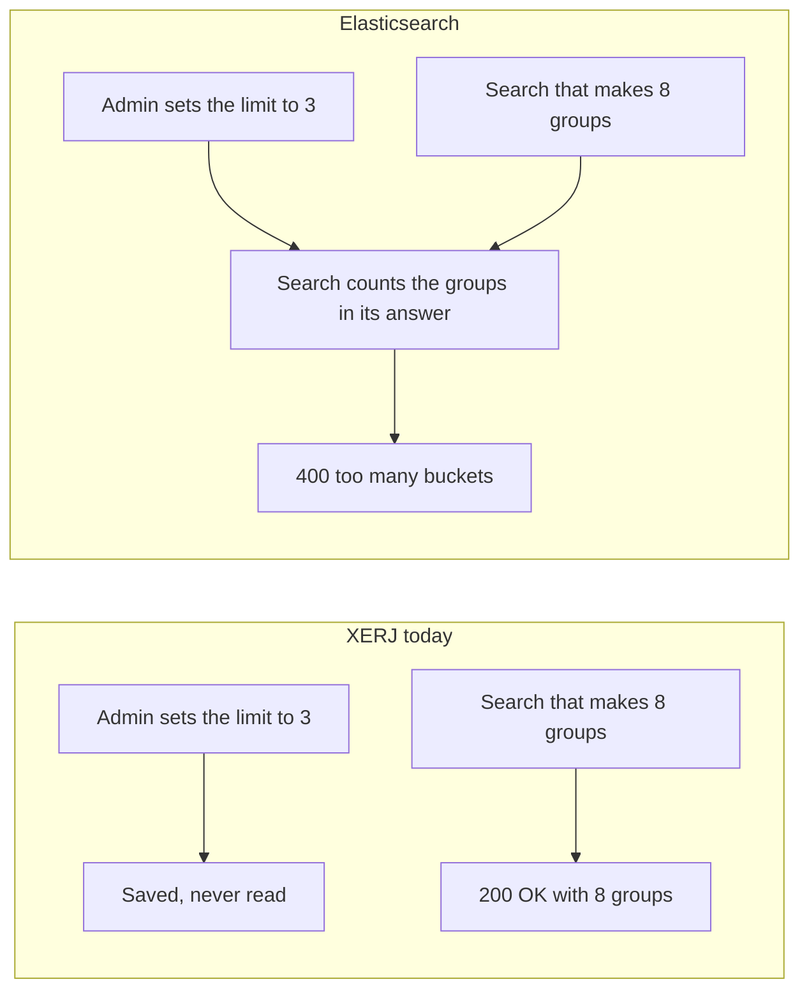
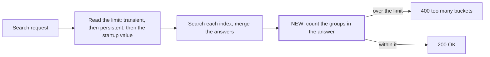

# Cluster setting `search.max_buckets` is saved but ignored by searches

**Ready to publish.** 2 decisions need your OK. Nothing is posted yet.

| | |
|---|---|
| **Area** | Search API, aggregations (the "group by" part of a search) |
| **The bug** | An admin can set a cluster-wide limit on how many groups one search may return. XERJ saves the setting, but no search ever reads it. |
| **Who notices** | Anyone who relies on the limit to stop runaway searches: XERJ answers searches that Elasticsearch refuses. |
| **The fix** | Each search reads the setting, counts the groups in its answer, and refuses with Elasticsearch's error when the count is over the limit. |
| **Size** | 1 source file (+178 / -6), 1 new test file (8 tests), a CHANGELOG entry, 1 line off the known-failures list |
| **Proof** | Without the fix, 6 of the 8 new tests fail (the other 2 guard against over-counting and pass either way); with it, all 8 pass. Elasticsearch compatibility suite: 1448 passed, 0 failed. |
| **Risk** | Medium: a search that works today can start failing (decision 1). |

## The problem

**Background.** An aggregation splits search results into groups called *buckets*, for example one bucket per product category with a count in each. Elasticsearch has a cluster setting, `search.max_buckets`, that caps the total number of buckets one search may return, so a single search cannot build millions of groups. Over the cap, Elasticsearch refuses the search with a 400 error.

**What XERJ does.** It stores the setting and shows it back, but nothing reads it. XERJ's only cap is a fixed value from its config file, read once at startup. That cap is a memory guard applied to each aggregation separately, and for the common kind of grouping it quietly stops adding groups instead of refusing. So a search Elasticsearch refuses gets a normal answer from XERJ.

## Options

| | What it does | For | Against |
|---|---|---|---|
| A | Feed the setting into the startup cap | Small | Counts the wrong thing (groups before the answer is trimmed), so it refuses searches Elasticsearch allows and allows some it refuses. Also lowers the memory guard for every search, and edits the same lines as another contributor's open PR (#2957). |
| **B, chosen** | For each search, count the groups in the final answer the way Elasticsearch does, and refuse with the same error | Matches Elasticsearch. Leaves the startup cap alone. Shares no lines with other open PRs. | One extra pass over the answer, only for searches that group. |
| C | B, and also lower the engine's cap for that one search | Would also save memory | Cannot work as built: each index is searched on its own task, which the per-search limit never reaches. |

A second agent, given the problem with no preferred answer, also picked B.

## The fix

`_search` and `_msearch` (several searches in one request) now read the limit, count the groups the answer keeps at every level of nesting, and return Elasticsearch's error when the count is over. In `_msearch`, only the search that goes over fails; the others still answer.

**Not checked against a real Elasticsearch:** that it gives a group-of-groups wrapper (such as a filter) no count of its own, and that it fails only the one `_msearch` search. Both come from reading Elasticsearch's source code.

## Decisions for you

1. **A default limit now applies to every search.** With no setting, the limit is the startup value (65536), but it is now counted across the whole answer instead of per aggregation. That is what Elasticsearch does. A XERJ user with a very large nested aggregation that works today could start getting 400s.
   - *Done:* matched Elasticsearch, and the CHANGELOG says so.
   - *Alternative:* enforce the limit only when someone sets it explicitly.
   - *Recommend:* keep it, and name it in the PR description.
2. **CHANGELOG conflicts.** The entry starts an empty "Unreleased, Fixed" section. All 5 of your open PRs also edit CHANGELOG, so whichever of these merges later will need a small rebase, on CHANGELOG lines only.
   - *Recommend:* accept it. The publish step trial-merges against every open PR and tells you which ones conflict before anything is opened.

## Not covered

| What | Why it matters | Own PR? |
|---|---|---|
| Scroll and async search ignore the setting too | The same gap on two less-used search paths | Yes, small |
| Bad values (negative, text) are accepted when saved; Elasticsearch refuses them | A different bug, in settings validation | Yes, small |
| `_msearch` keeps only the first index's groups and hides grouping errors | A separate `_msearch` bug, found along the way | Yes |
| A setting above the startup value cannot raise the engine's own cap | Needs an engine change, and touches open PR #2957 | Later |
| A few rare group types are not counted | Only ever too lenient, never a wrong refusal | No |
| The full test suites were not run here | Too heavy for this PC; upstream CI runs them | No |

## Review

An independent code review found 12 items: 0 high, 3 medium, 5 low and 4 nits. One medium was a real bug: a search across several indices counted groups the answer later drops, so it could refuse a valid search. A test proved it and the fix followed. The other two mediums are the engine cap and async search items under Not covered.

## Other open PRs nearby

The run compared 7 other open PRs that edit the same source file. None shares lines with this one. The closest, #2981, edits the block just above the new check.

---
PR title `fix(api): honour search.max_buckets from _cluster/settings`, body in [PR_BODY.md](PR_BODY.md) (537 words). Branch `fix/max-buckets-cluster-setting`: 4 commits on `1557de2f5`, head `4bb7c9243`. Where each claim comes from (logs, Elasticsearch source references, file-by-file changes, the full review table): [details.md](details.md).
