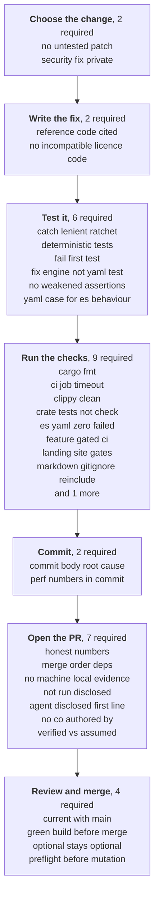

# What xerj-org/xerj expects from a contribution

**Learned, not yet approved.** Rules id `035333818500`. Runs on this repo refuse until you approve it with `contrib-run --repo xerj-org/xerj --approve-profile 035333818500`; to correct a rule, write the correction in the repo's overrides file.

| | |
|---|---|
| **Read** | 27 guide files, 2 files merged PRs often change, 1 file current rules cite, at base `50e4ffded551`; 30 merged PRs by outside contributors, 15 closed without merging |
| **Rules** | 32 required, 25 practices, 2 steps for you. Drafted by one session, checked and corrected by a second. Each rule with its reason and sources: [PROFILE-RULES.md](PROFILE-RULES.md) |
| **Left out** | nothing: every rule's sources checked out |
| **Sessions** | learn: $2.38; review: $2.91 (API-equivalent) |

## What the project cares about

- Every engine change keeps the ES-YAML conformance suite at 0 failed. ES gaps are fixed in the engine, never in the test, and catch-lenient.txt only shrinks.
- A fix ships with a regression test shown failing on unfixed code, plus fmt, clippy and cargo test -p for the touched crates.
- The PR body follows the template: root cause, evidence, checks, a Not run list naming every skipped check, and provenance that says an agent wrote it and splits verified from assumed.
- Every number comes from a command that was run. No Co-Authored-By trailers, and no machine-local paths as evidence.
- Maintainers squash-merge only on a green Build + Test after the branch is current with main, and the CLA check must be green.

## What a PR must do here

The required rules, at the step of a contribution where each applies. A PR that breaks one is likely sent back. Why each is required, and the practices, are in PROFILE-RULES.md.

## Steps for you

Things only you can do, by hand. Sessions never see these.

- Before a PR can merge, its account has signed the CLA once: its own PR adds only the username to .contributors, then @cla-bot check is commented on the PR. ([maintainer xerj-org on #2605](https://github.com/xerj-org/xerj/pull/2605))
- The human whose account opens the PR has read the change and stands behind it before it is sent. ([.github/AI_CONTRIBUTIONS.md](https://github.com/xerj-org/xerj/blob/50e4ffded5518b1822cfac5450fa34d3829ab8ab/.github/AI_CONTRIBUTIONS.md))

## What the review changed (23)

- fixed catch-lenient-ratchet: the second quote crossed a comment line break; replaced it with the part on one line
- made fail-first-test required: AI_CONTRIBUTIONS.md calls it non-negotiable and AGENTS.md says a PR requires it; added the AGENTS.md quote and more merged PRs
- made yaml-case-for-es-behaviour and fix-engine-not-yaml-test required: both are part of the non-negotiable or required sections of the guides
- made cargo-fmt and clippy-clean required: CI enforces both and AI_CONTRIBUTIONS.md lists fmt as non-negotiable; added PRs that named a pre-existing lint instead of suppressing it
- made scoped-release-build a practice: maintainers merged four ES fixes built with the quick profile that disclosed the skipped release build
- made agent-disclosed-first-line and verified-vs-assumed required: the PR template marks the Provenance block required for agent-written changes
- made commit-body-root-cause, perf-numbers-in-commit, no-untested-patch and reference-code-cited required: the guides state each as a requirement
- made pr-template-sections a practice and moved its do-not-delete quote to not-run-disclosed, which is the requirement that quote states
- and 15 more, in PROFILE-RULES.md
