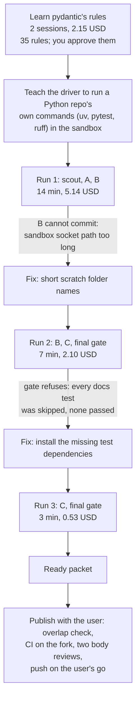

# Case study: a docs fix in pydantic

The pipeline's first contribution to a Python repository, from learning the repo's rules to
an open pull request. Every number below comes from the driver's own records (run summaries,
logs and results) or from GitHub.

## Outcome

[pydantic/pydantic#14276](https://github.com/pydantic/pydantic/pull/14276), opened
2026-11-13. A pydantic maintainer approved it and labeled it `relnotes-ignore` the same day;
as of 2026-11-15 it is not merged yet. It changes one file, `docs/concepts/json_schema.md` (5
lines added, 4 removed).

## The defect

Two places in pydantic's JSON Schema docs told readers to pass schema options
(`ref_template`, and `by_alias=False`) to `model_dump_json()`. That method serializes a
model's data; it does not produce a schema. It has no `ref_template` parameter, so the call
raises `TypeError`, and its `by_alias` changes the keys of the dumped data, not the schema.
The fix names `TypeAdapter.json_schema()`, which takes both options and is what the
section's own example already calls.

## Timeline

1. **Learn.** One session drafted pydantic's contribution rules from its guides and recent
   outside PRs; a second checked and corrected them (35 rules, 5 of them required). The user
   approved them by id after adding their own: the exact AI disclosure line, and never
   working an issue before being assigned to it.
2. **Run 1** (2026-11-12). The scout chose the defect. Stage A reproduced it: 2 tests that
   assert the docs' claims failed, and 4 control tests against the real methods passed.
   Stage B made the edit, and format and lint passed, but its commit failed with "Failed to
   create bridge sockets". The candidate stopped as needs-you with its work saved. Its draft
   commit message also said the page's examples passed, although the driver had recorded
   that all 26 docs tests were skipped (an optional test dependency was missing). That claim
   was caught outside the pipeline, while preparing the answer to the stop, and the answer
   told stage B to remove it.
3. **Run 2** (2026-11-13). Stage B corrected the message and committed, and stage C reviewed
   the change and wrote the packet. Stage B's own docs test request (expect any) was again
   all skipped and was recorded as met without a warning. The driver's final gate then
   refused: "no passing test requests were recorded".
4. **Run 3** (2026-11-13). With the dependency group installed, 25 of the 26 selected tests
   passed. The one failure, an example that needs the optional `email-validator` package,
   failed the same way on the unchanged base. The final gate passed on a fresh clone, and
   the candidate became ready.
5. **Publish.** Upstream had not moved, and the one open PR on the same page (#12684)
   merged cleanly with this branch in a trial merge. pydantic's CI ran on the user's fork
   first: the docs build and lint passed. A GraalPy test job and a benchmark upload failed
   and the macOS jobs were cancelled for lack of runners, none of them related to a docs
   change. Two review passes tightened the PR body, and the branch was pushed on the user's
   "push and open".

## Cost

| Step | Time | Cost (USD) |
|---|---|---|
| Learn the rules | | 2.15 |
| Run 1: scout 2.46, A 1.83, B 0.84 | 14 min | 5.14 |
| Run 2: B 0.70, C 1.40 | 7 min | 2.10 |
| Run 3: C | 3 min | 0.53 |
| **This contribution** | | **9.92** |
| Earlier pydantic learns while tuning the learn step (not approved) | | 4.71 |
| **All pydantic spend** | | **14.63** |

Costs are API-equivalent, as Claude Code reports them. The earlier learns are compared in
[tests/learn/COMPARISON.md](../tests/learn/COMPARISON.md). A later retest of the same commit
used no model time: the driver rebuilt the environment in 83 seconds and re-ran format, lint
and the docs tests.

## What broke, and what changed

| Problem | Found by | Change | Commit |
|---|---|---|---|
| The session's scratch folder made the sandbox's socket path 111 bytes; Linux allows 108 | Run 1 stop | Scratch folders get short hashed names, checked at startup | `9444683` |
| A session wrote a test claim the driver had recorded as all skipped, and a request with expect any counted an all-skipped run as met | Outside the pipeline, answering the stop (the claim); the final gate (the skips) | The repo's profile installs its test extras; sessions are told when every test was skipped; stage C's reviewer checks every number and claim | `6e07f93`, `8f14168` |
| A results file from a failed check outlived the fix | Run 2 | The file is cleared once the checks pass | `8f14168` |
| A session's command was blocked with no explanation | Run summaries (one denial in each of runs 1 and 2) | Each session's instructions list the commands blocked for it | `8f14168` |
| Publishing was written for one Rust repo and done by hand | Publishing this PR | `contrib-check` and the new `contrib-push` read everything from the repo's profile; the fork CI step is built in | `e284671` |

## What the person decided

The pipeline never published anything on its own. The user approved the learned rules,
chose to aim the run at a small docs fix with no issue, answered each needs-you question, chose to run CI
on their fork first, reviewed the PR title and body, and gave the go to push.

## Limits

- About 10 USD for a two-sentence docs fix is not an efficient way to fix typos; the scout
  alone cost 2.46 USD. The run is worth it as a test of the process, not on price.
- The false claim in the commit message was caught outside the pipeline. The pipeline now checks for
  it, but that check has not met a real case yet.
- The pipeline is built for one machine (see "Built for" in the README).
